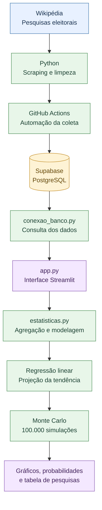

# Agregador de Pesquisas Eleitorais — Presidência 2026

Projeto de análise de dados que reúne pesquisas eleitorais de segundo turno, agrega seus resultados e utiliza modelos estatísticos para projetar tendências e estimar probabilidades em diferentes cenários.

🔗 **Acesse a aplicação:** [Agregador de Pesquisas Eleitorais](https://agregador-pesquisa-eleitoral-2026.streamlit.app/)

## ⚙️ Pipeline de dados

O pipeline automatiza a coleta e o tratamento das pesquisas, armazena os dados no PostgreSQL e alimenta a aplicação de visualização e análise estatística.

## 🛠️ Tecnologias

* **Python:** coleta, tratamento e análise dos dados.
* **Pandas e NumPy:** manipulação de dados e cálculos estatísticos.
* **Supabase / PostgreSQL:** armazenamento dos dados.
* **GitHub Actions:** automação do pipeline.
* **Streamlit e Plotly:** aplicação interativa e visualizações.
* **SQL:** consultas e integração dos dados.

## 📈 Metodologia

O modelo combina pesquisas selecionadas, pondera os resultados pela recência e pelo tamanho da amostra, aplica regressão linear para extrapolar a tendência e utiliza simulação de Monte Carlo para estimar a probabilidade de cada candidato ultrapassar 50% dos votos válidos.

Os resultados são **estimativas condicionadas aos dados e às premissas do modelo**, não garantias do resultado eleitoral. As projeções também estão sujeitas à incerteza e às limitações das pesquisas disponíveis.

Desenvolver um projeto de portfólio para praticar engenharia e análise de dados, automação de pipelines, SQL, modelagem estatística e construção de aplicações interativas.

